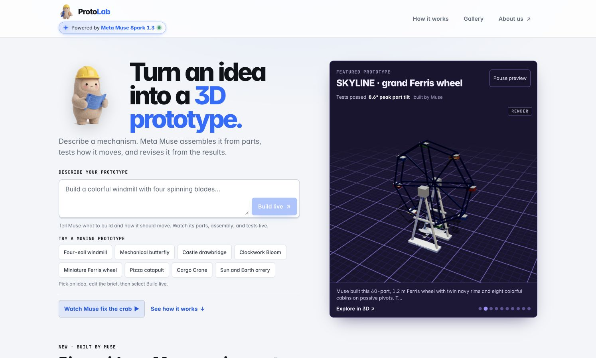

# ProtoLab

**Generative AI prototyping for mechanical engineering, powered by Meta Muse.**

Describe a mechanism in plain English. ProtoLab turns the brief into a connected 3D assembly,
runs physics tests, and lets Muse revise the design using measured results. Engineers, robotics
teams, makers, and students can explore mechanisms and compare alternatives before building hardware.

**[Try the live app](https://protolab.sean-abc.workers.dev)** ·
**[Watch Muse repair the crab](https://protolab.sean-abc.workers.dev/i/inv_633b4887ad7f4cdc?replay=1&compare=1)** ·
**[Explore the gallery](https://protolab.sean-abc.workers.dev/gallery)**

Built for the Meta Global AI Developer Hackathon.

[](https://protolab.sean-abc.workers.dev)

## Try it

Start with a prompt that describes both the mechanism and a measurable goal:

> Build a tabletop windmill with four bright sails on a grounded tower, using up to 12 parts.
> One motor turns the sails. Measure at least two turns in eight seconds and check that the
> sails clear the tower and floor.

Select **Build live** to watch parts being selected, the assembly taking shape, and successive
simulation results. Open a completed prototype to replay its tests, inspect its parts, compare
revisions, or request a change. Publish a build to share it; gallery visitors can create a remix.

These public examples contain saved assemblies and recorded simulation traces:

| Prototype | What to inspect |
| --- | --- |
| [Mechanical crab repair](https://protolab.sean-abc.workers.dev/i/inv_633b4887ad7f4cdc?replay=1&compare=1) | Failed and passing revisions under the same distance and tilt targets. |
| [ATLAS · six-cylinder machine](https://protolab.sean-abc.workers.dev/i/inv_616e8b95ede04b8d?replay=1&version=ver_52c54f258ec24abf) | 56 components; one motor drives six passive pistons and two flywheels. |
| [SKYLINE · grand Ferris wheel](https://protolab.sean-abc.workers.dev/i/inv_a2b991c4bb614ee1?replay=1&version=ver_cb8c608abe024f4c) | 60 components; eight hanging cabins remain upright as the wheel turns. |
| [OCTO · eight-arm camera sculpture](https://protolab.sean-abc.workers.dev/i/inv_5b8d9bc9fa68496b?replay=1&version=ver_d6b56c3fa6a34853) | 54 components; eight articulated arms move through 24 powered joints. |
| [Gravity Clock](https://protolab.sean-abc.workers.dev/i/inv_a1f1665e649b41c2?replay=1) | Inspect the pendulum, hands, and weight in a mechanical clock prototype. |

## How it works

1. **Plan.** Muse identifies the requested features, moving subassemblies, and measurable success criteria.
2. **Select or design parts.** Search 157 catalog presets, generate a parametric part, or create custom
   geometry from primitives, extruded profiles, and revolved profiles.
3. **Assemble.** Validated JSON tool calls place parts, mate connectors, create joints, and configure
   actuator drives. The browser shows the parts inventory and a live blueprint/3D assembly.
4. **Test.** Rapier runs fixed-step rigid-body simulations and records motion, clearance, stability,
   payload behavior, and motor demand against the declared targets.
5. **Revise.** Muse receives failure explanations and affected part IDs, changes the geometry or drives,
   and tests again. Saved versions retain their test definitions and results.
6. **Review and explore.** Native checks and a separate model review gate a passing finalization.
   The workbench exposes the evidence, revision history, explanations, and recorded replays.

### Meta Muse's role

- **Muse Spark 1.3** leads planning, part design, assembly, test definition, and revision through the Meta Model API.
- **Muse Wonder 1.0** is the default engineering specialist after repeated simulation or assembly-validation
  failures. It diagnoses and attempts a repair before handing control back to Spark. The default threshold is three failures.
- **A separate final design review**, using Wonder by default, checks the original brief against the placed
  geometry and native test evidence. Review findings return to the build loop as repair requirements.

Rapier produces the physics measurements; Muse interprets them and chooses design changes.
The UI and saved version records identify the model used. Model errors and specialist handoffs are visible.
API keys remain on the server.

### A repair you can inspect

The crab's original target was **at least 25 cm of sideways travel in six seconds, with no more than 10° of tilt**.

| Saved revision | Model | Sideways travel | Peak tilt | Result |
| --- | --- | ---: | ---: | --- |
| v3 | Muse Spark 1.3 | 0.27 cm | 14.28° | Failed |
| v4 | Muse Wonder 1.0 | 31.73 cm | 4.72° | Passed |

Muse revised the leg stance and gait, then ran the same requirements again.
[Compare both recorded runs in 3D](https://protolab.sean-abc.workers.dev/i/inv_633b4887ad7f4cdc?replay=1&compare=1).
These measurements describe the saved revisions; new builds are tested independently.

## Simulation scope and provenance

The simulator supports fixed, revolute, prismatic, and spring joints; anchored and free bodies;
position and velocity drives; and tests for walking, joint motion, rotation, launching, gripping,
clearance, payload retention, and mechanism timing. It uses a 1/240-second physics step and records
30 Hz replays. Assembly checks detect unsupported or detached parts, invalid attachments, and
geometry overlaps. Motor demand is checked against the configured part ratings. Sampled clearance
checks examine recorded poses; they do not establish continuous collision-free motion.

A passing result means the prototype met its recorded simulation checks. Aerodynamics, combustion,
fluids, deformation, fatigue, manufacturability, and physical safety require separate validation.
The Gravity Clock demonstrates mechanical motion; its tests do not establish timekeeping accuracy.
Fabrication and 3D-print export are not implemented.

The gallery includes **saved Muse builds and eight deterministic reference mechanisms**, such as
linkage, pump, lift, and indexing examples. Reference mechanisms are labeled `planner` / `deterministic-planner`
and have real simulation traces. Model provenance distinguishes them from Muse-generated designs.
Imported external meshes are decorative until engineering data is supplied; licenses and attribution
are documented in [third-party parts](docs/third-party-parts.md).

## Run locally

Use **Node.js 22.18+** and npm. The scripts use Node's [built-in TypeScript support](https://nodejs.org/en/blog/release/v22.18.0)
and `node:sqlite`. A Meta Model API key with access to the configured models enables generative builds.

```bash
git clone https://github.com/seandmccue/proto-lab.git
cd proto-lab
npm ci
cp .env.example .env
# Set MODEL_API_KEY in .env, then:
npm run dev
```

Open [localhost:5173](http://localhost:5173). The API runs on [localhost:8787](http://localhost:8787).
On a fresh database, startup queues three example builds (butterfly, Ferris wheel, and catapult)
and creates the eight reference mechanisms. With a model key configured, startup and example builds make API calls.

Without a key, the UI identifies the deterministic planner. This mode demonstrates a limited
legged-walker workflow; use Muse for arbitrary mechanical briefs.

### Model and job settings

Set these in the repository-root `.env` for local development:

```dotenv
MODEL_API_BASE=https://api.meta.ai/v1
MODEL_API_KEY=your_meta_api_key
MODEL_ID=muse-spark-1.3
MODEL_SPECIALIST_ID=muse-wonder-1.0
MODEL_SPECIALIST_AFTER=3
AGENT_TIME_BUDGET_S=1200
```

An empty `MODEL_SPECIALIST_ID` disables the separate specialist. Builds are bounded by time,
model-round, tool-call, and simulation-test budgets. Completed versions remain available if a job
stops; changed assemblies without current test evidence are labeled **Not tested**.
Build duration varies with the prompt, repairs, queue load, and model latency.

| Setting | Local default | Checked-in Cloudflare deployment default |
| --- | --- | --- |
| Model transport | Chat Completions | `responses-encrypted` |
| Spark Responses reasoning effort | Unset | `low` |
| Wonder Responses reasoning effort | Unset | `high` |
| Concurrent / queued builds | 3 / 12 | 2 / 6 |

`MODEL_TRANSPORT=responses-encrypted` enables encrypted Responses continuation locally;
`MODEL_TRANSPORT=chat` selects Chat Completions. `MODEL_RESPONSES_REASONING_EFFORT`,
`MODEL_SPECIALIST_TRANSPORT`, and `MODEL_SPECIALIST_REASONING_EFFORT` configure the corresponding
model settings. `JOB_CONCURRENCY` and `JOB_MAX_QUEUED` control local job capacity.
See [the model configuration code](packages/agent/src/llm.ts) and [Cloudflare worker](deploy/cloudflare/worker.js)
for the full configuration and deployment overrides.

### Saved creations

`DATA_DIR` stores SQLite metadata and the `store/` directory containing manifests, traces, and previews.
Use an **absolute `DATA_DIR`** when switching launch commands: the default `./data` resolves to
`apps/api/data` under `npm run dev`, but to repository-root `data` under `npm start`.
Keep the database and object store together when backing up or moving creations.

Ownership uses an anonymous browser session. Private builds and owner-only edits depend on that
session; public links can be viewed and remixed from another browser.

## Development and verification

```bash
npm run typecheck
npm test
npm run build
npm start                  # production web app and API on port 8787
```

Check a running deployment without starting a new build:

```bash
npm run preflight -- --api https://protolab.sean-abc.workers.dev --web https://protolab.sean-abc.workers.dev
```

The preflight checks the live model status, featured gallery, examples, and web app. Add `--judge`
for the curated replay and demo checks. A planner-only local setup or a gallery still building its
initial examples will not satisfy all live-demo checks.

The [general benchmark notes](docs/benchmark-general.md) and [walker benchmark notes](docs/benchmark.md)
record historical experiments and failure analyses. They describe specific engine snapshots;
results and timings should not be treated as guarantees for new prompts or later releases.

## Repository layout

| Directory | Responsibility |
| --- | --- |
| `apps/web` | React, Vite, React Three Fiber, and Tailwind; homepage, live build, workbench, gallery, and remix flows. |
| `apps/api` | Hono on Node; SQLite, stored artifacts, API routes, worker-thread jobs, and checkpoints. |
| `packages/schema` | Validated definitions for parts, assemblies, controllers, tests, and versions. |
| `packages/parts` | Catalog presets, parametric geometry, connectors, and assembly operations. |
| `packages/simulator` | Rapier physics, measurements, structural and clearance checks, and replay traces. |
| `packages/agent` | Meta model clients, tool execution, design/repair loop, and independent review. |
| `deploy/cloudflare` | Worker routing, container settings, and private R2 checkpoint handling. |

## Cloudflare deployment

A Cloudflare Worker routes requests to a single container running the API, simulator, and built web app.
A private R2 checkpoint preserves SQLite metadata, assemblies, simulation traces, and previews across
container restarts. Restore verifies the checkpoint before serving; successful persisted mutations
wait for a durable checkpoint. Storage or model errors remain visible to the user.

Follow the [deployment and restore guide](deploy/cloudflare/README.md) to configure the container,
private R2 bucket, secrets, backup, and recovery. Keep API keys and checkpoint credentials outside Git.

Further documentation: [architecture](docs/architecture.md) · [geometry engine](docs/geometry-engine.md) ·
[third-party asset attribution](docs/third-party-parts.md).
